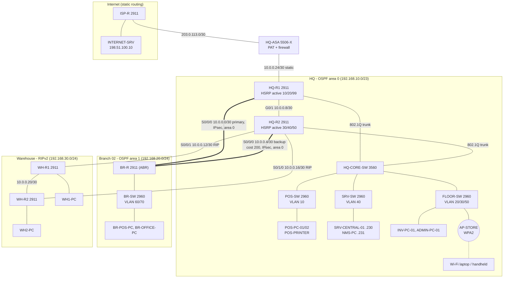

# 23Z510 Computer Networks Laboratory — Mini Project Report
## SuperMart: Enterprise Network for a Supermarket Retail Chain

**Scenario.** SuperMart runs a hypermarket (HQ), a remote branch store (Branch 02) and a distribution warehouse. Billing (POS) counters at every site must reach the central billing/inventory server at HQ, staff use handheld scanners on Wi-Fi, and the company needs internet access through a firewall. The network is implemented in Cisco Packet Tracer 9.0.1 (`cisco-network/pkt-files/SuperMart.pkt`), and the device configurations are in `cisco-network/configs/`.

### Checklist → where it is implemented

| # | Item | Implemented in | Proof (command / screenshot) |
|---|---|---|---|
| A1 | Assessment, logical + physical diagram | §A1 | Diagrams below |
| A2 | Star / bus / mesh / hybrid | §A2 | — |
| A3 | Hardware selection | §A3 | — |
| A4 | Scalability, security, redundancy | §A4 | — |
| B1 | IP definition, binary, usable range | §B1 | — |
| B2 | Subnetting table | §B2 | — |
| B3 | VLSM | §B3, all router configs | `show ip interface brief` |
| B4 | CIDR + summarised route on a router | BR-R `area 1 range`, HQ-R2 `summary-address`, HQ-ASA `route inside 192.168.0.0 255.255.224.0` | `show ip route` on HQ-R1, `show route` on ASA |
| C1 | Static routing | HQ-R1 default route, HQ-ASA routes | `show ip route static` |
| C2 | RIP + timers + updates | HQ-R2, WH-R1, WH-R2 | `show ip protocols`, `debug ip rip` |
| C3 | OSPF ≥2 areas + LSAs | HQ-R1, HQ-R2, BR-R (ABR) | `show ip ospf database` |
| C4 | RIP vs OSPF convergence | §C4 experiments | ping loss counts |
| D1 | DHCP + options + troubleshooting | HQ-R1, BR-R, WH-R1/2 pools | `show ip dhcp binding` |
| D2 | DNS, HTTP/HTTPS | SRV-CENTRAL-01 | `nslookup`, browser |
| D3 | SMTP + POP3 | SRV-CENTRAL-01 | Email client send/receive |
| D4 | FTP, printer sharing | SRV-CENTRAL-01, POS-PRINTER | `ftp`, ping printer |
| D5 | DHCP/SMTP/POP3 PDUs | Simulation mode | `verification/test-logs/simulation-mode-pdu-analysis.md` |
| E1 | VLANs + inter-VLAN routing | Router-on-a-stick on HQ-R1/HQ-R2, BR-R | `show vlan brief`, `show interfaces trunk` |
| E2 | Dual-router redundancy + load balancing | HSRP, split active roles per VLAN | `show standby brief` |
| E3 | Site-to-site VPN | IPsec HQ-R1/HQ-R2 ↔ BR-R | `show crypto ipsec sa` |
| E4 | ACLs, port security, SSH, firewall | Routers, access switches, HQ-ASA | `show access-lists`, `show port-security` |
| E5 | Wireless WPA2 | AP-STORE (AccessPoint-PT) | Laptop associates, gets DHCP |
| E6 | SNMP | All routers/switches, NMS-PC MIB browser | MIB browser walk |
| F1 | Packet trace with PDU details | §F | Screenshot of PDU details |

---

# SECTION A — Network Design and Planning

## A1. Network assessment, requirements and proposed design

**Sites and users (assessment)**

| Site | Users / devices | Requirements |
|---|---|---|
| HQ hypermarket | ~200 POS devices (counters, receipt printers, card terminals, self-checkout), ~100 Wi-Fi handhelds, ~50 inventory PCs, ~25 admin PCs, servers | POS must keep working if a router fails; POS isolated from everything except the billing server (PCI-DSS) |
| Branch 02 | ~50 POS devices, ~20 office PCs | Encrypted link to the HQ server; keeps working if one WAN link fails |
| Distribution warehouse | ~50 dispatch PCs, ~20 cold-storage PCs (two buildings) | Low-cost routing between two buildings and HQ |
| Internet | All sites (except POS) | Filtered access through a firewall; nothing reachable from outside |

**Requirements derived**
1. Segmentation: one VLAN per department so broadcast domains and security policy follow job roles.
2. Gateway redundancy at HQ: two routers sharing a virtual gateway (HSRP), with both routers carrying traffic.
3. WAN redundancy for the branch: two serial links, and OSPF reroutes automatically.
4. Confidentiality across the WAN: IPsec VPN between branch and HQ.
5. Centralised services: DHCP, DNS, web, e-mail, FTP, syslog, SNMP monitoring.
6. Edge security: an ASA firewall with NAT/PAT and a default-deny inbound policy.
7. Room to grow: hierarchical addressing that summarises well.

**Proposed design (logical diagram)**



Routing domains: **static** at the internet edge, **OSPF area 0** across HQ and both WAN links, **OSPF area 1** inside the branch, **RIPv2** in the warehouse triangle. HQ-R2 redistributes RIP into OSPF (ASBR), HQ-R1 injects the default route (ASBR), and BR-R is the ABR.

**Physical diagram (where the equipment sits)**

```
 HQ HYPERMARKET (Building A)                                      BRANCH 02 (Building B, 12 km)
 +-----------------------------------------------------------+   +-----------------------------+
 | SERVER ROOM - 42U rack                                    |   | Comms cabinet               |
 |   [HQ-ASA 5506-X] --(Cat6)-- ISP hand-off (fibre NTU)    |   |   [BR-R 2911]               |
 |   [HQ-R1 2911]  [HQ-R2 2911]   <- leased serial lines --+---+-->  S0/0/0, S0/0/1            |
 |   [HQ-CORE-SW 3560]                                       |   |   [BR-SW 2960]              |
 |   [SRV-SW 2960] [SRV-CENTRAL-01] [NMS-PC]                 |   |        | Cat6               |
 |        | Cat6 uplinks (vertical cabling)                  |   |   Branch POS + office PCs   |
 | SALES FLOOR - billing area   | BACK OFFICE + STOCK ROOM   |   +-----------------------------+
 |   [POS-SW 2960]              |   [FLOOR-SW 2960]          |
 |   counters 1..N + printers   |   inventory PCs, admin PCs |   WAREHOUSE (Buildings C + D)
 |                              |   (AP-STORE) ceiling mount |   +-----------------------------+
 +-----------------------------------------------------------+   | Dispatch bay   Cold storage |
            |  leased serial lines to the warehouse                | [WH-R1]--serial--[WH-R2]    |
            +----------------------------------------------------->|  WH1-PC          WH2-PC     |
                                                                    +-----------------------------+
```

## A2. Topology justification

| Topology | How it works | Where it is used in SuperMart | Why |
|---|---|---|---|
| **Star** | Every device has its own cable to a central switch | Every access switch: POS-SW, FLOOR-SW, SRV-SW, BR-SW and their PCs/printers/AP | One faulty cable or PC affects only that counter. Easy to add counters. Cheap. |
| **Extended star / tree** | Stars hang off a central star | HQ-CORE-SW at the centre, the three access switches as the arms | Hierarchical core/access design; broadcast and fault domains stay contained |
| **Mesh (partial)** | Extra links so there are multiple paths | WAN triangle HQ-R1–HQ-R2–BR-R; warehouse triangle HQ-R2–WH-R1–WH-R2; both HQ routers into the core | Any single WAN link can fail and routing (OSPF/RIP) finds the other path. A full mesh would cost n(n−1)/2 links, which is too expensive for retail sites. |
| **Bus** | All devices share one cable; a break stops everyone; collisions | **Not used** | One fault would stop all billing. Shared bandwidth and collisions are unacceptable for POS. |
| **Hybrid** | A combination of the above | **The whole network**: star access + extended star HQ + partial mesh WAN | Cheap, simple star at the edge, with redundancy only where an outage is expensive (core/WAN) |

## A3. Hardware selection and purpose

| Device | PT model | Qty | Purpose in SuperMart |
|---|---|---|---|
| **Router** | Cisco 2911 (+HWIC-2T serial cards) | 6 | Routes between subnets/sites. HQ-R1/HQ-R2 do inter-VLAN routing, HSRP and VPN. BR-R and WH-R1/2 are site gateways. ISP-R simulates the provider. 2911 because it has 3 GigE ports, HWIC slots for serial WAN, and the securityk9 licence for IPsec. |
| **Multilayer switch** | Cisco 3560-24PS | 1 | HQ core: VLAN database, trunks to both routers and the access switches, STP root. It could also route between VLANs (SVIs); we keep routing on the routers so HSRP covers it. |
| **Access switch** | Cisco 2960-24TT | 4 | Connects end devices to their VLAN; enforces port security, PortFast and BPDU guard. |
| **Hub** | Hub-PT | 0 | **Not used.** A hub repeats every frame out every port (one collision domain, half duplex, anyone can sniff card data). Switches forward by MAC address, with each port its own collision domain. |
| **Modem** | (DSL/Cable modem) | 0 in PT | Converts the ISP's line signal (DSL/cable/fibre) to Ethernet. In a real deployment it would sit between HQ-ASA and the ISP. In PT the ISP gives an Ethernet hand-off directly (ISP-R G0/0), so no modem object is needed. |
| **Access point** | AccessPoint-PT | 1 | Bridges Wi-Fi handhelds into VLAN 50 with WPA2-PSK/AES. |
| **Firewall** | Cisco ASA 5506-X | 1 | Internet edge: stateful inspection, PAT, and inside/outside ACL policy. |
| **Server** | Server-PT | 2 | SRV-CENTRAL-01: DNS, HTTP/HTTPS, SMTP/POP3, FTP, syslog. INTERNET-SRV simulates a site on the internet. |
| **NMS** | PC-PT | 1 | SNMP manager (MIB browser) at 192.168.11.231 |
| **End devices** | PC-PT, Laptop-PT (WPC300N), Printer-PT | ~10 | POS counters, office PCs, Wi-Fi client, receipt printer |
| **Cables** | Copper straight-through, copper cross-over, Serial DCE | — | Straight-through between unlike devices, cross-over between like devices (router–router GigE, router–PC), serial DCE for WAN links |

## A4. Scalability, security and redundancy plans

**Scalability**
- Hierarchical addressing: HQ = `192.168.10.0/23`, Branch = `192.168.20.0/24`, Warehouse = `192.168.30.0/24`, WAN links = `10.0.0.0/27`. The whole company summarises to `192.168.0.0/19`, so the firewall needs one inside route regardless of how many subnets are added.
- New branches take the next free /24 (`192.168.21.0`, `.22.0` …), still inside `192.168.0.0/19`. Each one becomes a new OSPF area behind its own ABR, and the ABR advertises a single summary.
- Multi-area OSPF keeps each LSDB small. The ABR summary means a branch link flap does not trigger SPF everywhere.
- Access switches have spare ports (shut down until used). The 3560 can take extra access switches on Fa0/4–24.

**Security (defence in depth)**

| Layer | Control |
|---|---|
| Physical/L2 | Port security (sticky MAC, max 1–2), BPDU guard, unused ports shut and placed in black-hole VLAN 999, native VLAN 999 (not VLAN 1 or the mgmt VLAN), DTP disabled (`nonegotiate`) |
| L3 internal | ACL-POS-IN (PCI scope: POS can reach only the billing server), ACL-WIFI-IN (Wi-Fi isolated from internal LANs) |
| Management | SSH v2 only, local users, VTY access-class (Admin VLAN 30 and Mgmt VLAN 99 only), `service password-encryption`, `enable secret`, MOTD banner |
| WAN | IPsec (AES-256 IKE, AES ESP + SHA HMAC) on both branch links |
| Edge | ASA: default-deny inbound, egress limited to DNS/HTTP/HTTPS/ICMP, PAT hides internal addressing |
| Monitoring | SNMP read-only community, syslog to SRV-CENTRAL-01 |

**Redundancy**
- **Gateway:** HSRP on two routers, with priorities split per VLAN (load sharing).
- **WAN:** two serial links to the branch, and OSPF fails over automatically. The VPN exists on both links.
- **Warehouse:** RIP triangle, so either warehouse router survives the loss of its direct link to HQ.
- **L2:** Rapid-PVST with the core as root.
- **Known single points of failure + upgrade path:** the core switch (upgrade: second 3560 with dual-homed access switches), the ASA (upgrade: active/standby ASA pair) and the single ISP (upgrade: second ISP with IP SLA tracking).

---

# SECTION B — IP Addressing

## B1. IP address, binary conversion and usable range

An **IPv4 address** is a 32-bit logical address that identifies an interface on a network. It is written as four decimal octets (dotted decimal). The **subnet mask** (or prefix length /n) splits it into a **network part** (first n bits, same for every host in the subnet) and a **host part** (remaining 32−n bits). The address with all host bits 0 is the **network address**, and the one with all host bits 1 is the **broadcast address**. Everything in between is usable: **2^(32−n) − 2 hosts**.

**Worked example — SRV-CENTRAL-01 `192.168.11.230/28`**

| | Octet 1 | Octet 2 | Octet 3 | Octet 4 |
|---|---|---|---|---|
| Address 192.168.11.230 | 11000000 | 10101000 | 00001011 | 1110 0110 |
| Mask /28 = 255.255.255.240 | 11111111 | 11111111 | 11111111 | 1111 0000 |
| AND → network 192.168.11.224 | 11000000 | 10101000 | 00001011 | 1110 0000 |
| Host bits all 1 → broadcast 192.168.11.239 | 11000000 | 10101000 | 00001011 | 1110 1111 |

- 230 = 128 + 64 + 32 + 4 + 2 → `11100110`; 11 = 8 + 2 + 1 → `00001011`; 168 = 128 + 32 + 8 → `10101000`.
- Host bits = 32 − 28 = 4 → 2⁴ = 16 addresses, **14 usable**.
- **Usable range: 192.168.11.225 – 192.168.11.238** (.225 = HSRP VIP, .226 HQ-R1, .227 HQ-R2, .230 server, .231 NMS).

## B2. Subnetting plan

| Subnet | Purpose | Network | Mask | CIDR | Usable range | Broadcast | Usable hosts | Gateway |
|---|---|---|---|---|---|---|---|---|
| VLAN 10 | POS-BILLING (HQ) | 192.168.10.0 | 255.255.255.0 | /24 | .10.1 – .10.254 | 192.168.10.255 | 254 | .10.1 (VIP) |
| VLAN 50 | STORE-WIFI | 192.168.11.0 | 255.255.255.128 | /25 | .11.1 – .11.126 | 192.168.11.127 | 126 | .11.1 (VIP) |
| VLAN 20 | INVENTORY | 192.168.11.128 | 255.255.255.192 | /26 | .11.129 – .11.190 | 192.168.11.191 | 62 | .11.129 (VIP) |
| VLAN 30 | ADMIN | 192.168.11.192 | 255.255.255.224 | /27 | .11.193 – .11.222 | 192.168.11.223 | 30 | .11.193 (VIP) |
| VLAN 40 | SERVERS | 192.168.11.224 | 255.255.255.240 | /28 | .11.225 – .11.238 | 192.168.11.239 | 14 | .11.225 (VIP) |
| VLAN 99 | NET-MGMT | 192.168.11.240 | 255.255.255.240 | /28 | .11.241 – .11.254 | 192.168.11.255 | 14 | .11.241 (VIP) |
| VLAN 60 | BR-POS | 192.168.20.0 | 255.255.255.192 | /26 | .20.1 – .20.62 | 192.168.20.63 | 62 | .20.1 |
| VLAN 70 | BR-OFFICE | 192.168.20.64 | 255.255.255.224 | /27 | .20.65 – .20.94 | 192.168.20.95 | 30 | .20.65 |
| WH1 LAN | Dispatch | 192.168.30.0 | 255.255.255.192 | /26 | .30.1 – .30.62 | 192.168.30.63 | 62 | .30.1 |
| WH2 LAN | Cold storage | 192.168.30.64 | 255.255.255.224 | /27 | .30.65 – .30.94 | 192.168.30.95 | 30 | .30.65 |
| P2P 1 | HQ-R1 S0/0/0 ↔ BR-R S0/0/0 | 10.0.0.0 | 255.255.255.252 | /30 | .1 – .2 | 10.0.0.3 | 2 | — |
| P2P 2 | HQ-R2 S0/0/0 ↔ BR-R S0/0/1 | 10.0.0.4 | 255.255.255.252 | /30 | .5 – .6 | 10.0.0.7 | 2 | — |
| P2P 3 | HQ-R1 G0/1 ↔ HQ-R2 G0/1 | 10.0.0.8 | 255.255.255.252 | /30 | .9 – .10 | 10.0.0.11 | 2 | — |
| P2P 4 | HQ-R2 S0/0/1 ↔ WH-R1 S0/0/0 | 10.0.0.12 | 255.255.255.252 | /30 | .13 – .14 | 10.0.0.15 | 2 | — |
| P2P 5 | HQ-R2 S0/1/0 ↔ WH-R2 S0/0/0 | 10.0.0.16 | 255.255.255.252 | /30 | .17 – .18 | 10.0.0.19 | 2 | — |
| P2P 6 | WH-R1 S0/0/1 ↔ WH-R2 S0/0/1 | 10.0.0.20 | 255.255.255.252 | /30 | .21 – .22 | 10.0.0.23 | 2 | — |
| P2P 7 | HQ-R1 G0/2 ↔ HQ-ASA inside | 10.0.0.24 | 255.255.255.252 | /30 | .25 – .26 | 10.0.0.27 | 2 | — |
| Public | HQ-ASA outside ↔ ISP-R | 203.0.113.0 | 255.255.255.252 | /30 | .1 – .2 | 203.0.113.3 | 2 | 203.0.113.1 |
| Internet | ISP server LAN | 198.51.100.0 | 255.255.255.0 | /24 | .1 – .254 | 198.51.100.255 | 254 | .1 |

**Static/reserved addresses:** POS-PRINTER 192.168.10.5, SRV-CENTRAL-01 192.168.11.230, NMS-PC 192.168.11.231, switch SVIs 192.168.11.244–.247 (VLAN 99) and 192.168.20.66 (BR-SW), INTERNET-SRV 198.51.100.10. In every HSRP subnet: first usable = virtual gateway, second = HQ-R1, third = HQ-R2.

## B3. VLSM — departments of different sizes

VLSM assigns each subnet the **smallest mask that fits its host count**, allocating the **largest subnets first** so every block starts on a valid boundary. Doing this with fixed /24s (the "classful" way) would use six /24s = 1536 addresses for HQ. VLSM fits HQ into **one /23 (512 addresses)**.

**HQ block 192.168.10.0/23**

| Step | Department | Hosts needed | Smallest 2ⁿ−2 ≥ need | Mask | Allocated | Next free |
|---|---|---|---|---|---|---|
| 1 | POS (VLAN 10) | 200 | 254 (n=8) | /24 | 192.168.10.0/24 | 192.168.11.0 |
| 2 | Wi-Fi (VLAN 50) | 100 | 126 (n=7) | /25 | 192.168.11.0/25 | 192.168.11.128 |
| 3 | Inventory (VLAN 20) | 50 | 62 (n=6) | /26 | 192.168.11.128/26 | 192.168.11.192 |
| 4 | Admin (VLAN 30) | 25 | 30 (n=5) | /27 | 192.168.11.192/27 | 192.168.11.224 |
| 5 | Servers (VLAN 40) | 10 | 14 (n=4) | /28 | 192.168.11.224/28 | 192.168.11.240 |
| 6 | Mgmt (VLAN 99) | 10 | 14 (n=4) | /28 | 192.168.11.240/28 | — (block full) |

**Branch block 192.168.20.0/24:** BR-POS 50 → /26 `192.168.20.0/26`, BR-OFFICE 20 → /27 `192.168.20.64/27`, `192.168.20.96 – .255` spare.
**Warehouse block 192.168.30.0/24:** Dispatch 50 → /26 `192.168.30.0/26`, Cold storage 20 → /27 `192.168.30.64/27`, rest spare.
**WAN block 10.0.0.0/27:** every point-to-point link needs exactly 2 hosts → /30 (2²−2 = 2). Seven /30s use 10.0.0.0–10.0.0.27, and 10.0.0.28/30 is spare. A /24 per link would waste 252 addresses each.

## B4. CIDR and route summarisation

**CIDR** (Classless Inter-Domain Routing) drops the class A/B/C boundaries: a route is any prefix/length. **Summarisation (supernetting)** advertises several contiguous networks as one shorter prefix: keep the bits all the networks share and set the rest to 0.

**Summary 1 — Branch, configured on BR-R (OSPF inter-area summary)**
```
192.168.20.0/26   = 192.168.20.0   -> 4th octet 00000000
192.168.20.64/27  = 192.168.20.64  -> 4th octet 01000000
common bits: 24 (first three octets)  ->  192.168.20.0/24
```
```cisco
BR-R(config)# router ospf 1
BR-R(config-router)# area 1 range 192.168.20.0 255.255.255.0
```
Result on HQ-R1: a single `O IA 192.168.20.0/24 [110/65] via 10.0.0.2, Serial0/0/0` instead of two routes. BR-R also installs `192.168.20.0/24 is a summary, Null0` (discard route to prevent loops).

**Summary 2 — Warehouse, configured on HQ-R2 (OSPF external summary)**
```cisco
HQ-R2(config-router)# summary-address 192.168.30.0 255.255.255.0
```
Result elsewhere in OSPF: `O E2 192.168.30.0/24 [110/20] via ...` instead of /26 + /27.

**Summary 3 — Whole company, static on HQ-ASA**
```
192.168.10.x -> 3rd octet 000 01010
192.168.11.x -> 3rd octet 000 01011
192.168.20.x -> 3rd octet 000 10100
192.168.30.x -> 3rd octet 000 11110
common bits: 16 + 3 = 19  ->  192.168.0.0/19 (255.255.224.0), range 192.168.0.0 - 192.168.31.255
```
```
HQ-ASA(config)# route inside 192.168.0.0 255.255.224.0 10.0.0.25
HQ-ASA(config)# route inside 10.0.0.0 255.255.255.224 10.0.0.25
```
The same /19 is the PAT object (`object network SUPERMART-LANS`). The HQ OSPF statement `network 192.168.10.0 0.0.1.255 area 0` is also a CIDR wildcard: it matches the whole /23 in one line.

---

# SECTION C — Routing

## C1. Static routing

A static route is entered by hand. It has administrative distance **1**, sends no updates and uses no CPU, but it does not react to failures.

```cisco
HQ-R1(config)# ip route 0.0.0.0 0.0.0.0 10.0.0.26          ! default route to the firewall
HQ-R1(config)# router ospf 1
HQ-R1(config-router)# default-information originate        ! share it with all OSPF routers
HQ-ASA(config)# route outside 0.0.0.0 0.0.0.0 203.0.113.1  ! default to the ISP
HQ-ASA(config)# route inside 192.168.0.0 255.255.224.0 10.0.0.25
HQ-ASA(config)# route inside 10.0.0.0 255.255.255.224 10.0.0.25
```
Verify: `show ip route static` → `S* 0.0.0.0/0 [1/0] via 10.0.0.26`. On the branch: `O*E2 0.0.0.0/0 [110/1] via 10.0.0.1`. On the warehouse: `R* 0.0.0.0/0 [120/1]` (HQ-R2 runs `default-information originate` in RIP).

Static routing fits the edge because the firewall has exactly one way out. Inside, where there are alternate paths, dynamic protocols are used.

## C2. RIP (distance vector)

**Where:** the warehouse triangle HQ-R2 – WH-R1 – WH-R2 (RIPv2, `no auto-summary`, so VLSM masks are carried).

**How it works:** Bellman-Ford. Each router sends its whole routing table to its neighbours, and the metric is **hop count** (max 15; 16 = unreachable). RIPv2 multicasts to **224.0.0.9 on UDP 520** and carries the subnet mask. Loop prevention: split horizon, route poisoning (metric 16), poison reverse, hold-down and triggered updates.

**Timers** (`timers basic 30 180 180 240`, the defaults, shown explicitly in the configs)

| Timer | Value | Meaning |
|---|---|---|
| Update | 30 s | Every 30 s (with small jitter) each router multicasts its full table |
| Invalid | 180 s | No update for a route for 180 s → route marked invalid ("possibly down", metric 16) |
| Hold-down | 180 s | After a route goes invalid, worse-metric updates for it are ignored, which stops count-to-infinity loops |
| Flush | 240 s | 240 s after the last update the route is deleted from the table |

**Verifying update behaviour**
```cisco
WH-R1# show ip protocols
  Routing Protocol is "rip"
  Sending updates every 30 seconds, next due in 12 seconds
  Invalid after 180 seconds, hold down 180, flushed after 240
  ...
WH-R1# show ip route rip
R*   0.0.0.0/0 [120/1] via 10.0.0.13, 00:00:17, Serial0/0/0     <- age resets to 0 every ~30 s
R    192.168.30.64/27 [120/1] via 10.0.0.22, 00:00:09, Serial0/0/1
WH-R1# debug ip rip
RIP: sending v2 update to 224.0.0.9 via Serial0/0/1 (10.0.0.21)
RIP: received v2 update from 10.0.0.13 on Serial0/0/0
WH-R1# undebug all
```
The `00:00:17` age column counting up to ~30 and then resetting shows the periodic updates.

## C3. OSPF (link state), two areas, LSAs

**How it works:** each router floods **LSAs** describing its links, every router in an area builds the same **LSDB**, and each one runs **Dijkstra SPF** to compute the shortest-path tree. Metric = **cost = 10⁸ / bandwidth** (GigE = 1, serial 1.544 Mb/s = 64; the backup serial is forced to 200). It runs over IP protocol 89, multicast 224.0.0.5 (all OSPF routers) and 224.0.0.6 (DR/BDR). Hello 10 s, dead 40 s on these links. AD = 110.

**Areas in SuperMart**

| Area | Members | Notes |
|---|---|---|
| **Area 0 (backbone)** | HQ-R1, HQ-R2, BR-R; all HQ VLAN subnets; the three links 10.0.0.0/30, 10.0.0.4/30, 10.0.0.8/30 | The WAN triangle is in the backbone, so failover between the two branch links happens inside one area |
| **Area 1** | BR-R's branch LANs 192.168.20.0/26 and 192.168.20.64/27 | Summarised by the ABR to 192.168.20.0/24 |

**Router roles:** BR-R = **ABR** (interfaces in area 0 and 1). HQ-R1 = **ASBR** (injects the static default). HQ-R2 = **ASBR** (redistributes RIP). On the HQ-R1–HQ-R2 GigE link (broadcast network type) a **DR/BDR** is elected (highest priority, then highest router-ID, so HQ-R2 normally becomes DR unless HQ-R1 booted first). The serial links are point-to-point, with no DR.

**LSA types — what each one is and where it appears in this network**

| Type | Name | Originated by | Flooding scope | In SuperMart |
|---|---|---|---|---|
| 1 | Router LSA | Every router | Its own area | HQ-R1, HQ-R2, BR-R in area 0; BR-R in area 1 |
| 2 | Network LSA | DR of a multi-access segment | Its own area | DR of 10.0.0.8/30 (HQ-R1 ↔ HQ-R2 Ethernet) |
| 3 | Summary LSA | ABR | Into other areas | BR-R → area 0: **192.168.20.0/24** (the summary). BR-R → area 1: all area-0 networks |
| 4 | ASBR-summary LSA | ABR | Into other areas | BR-R → area 1: "how to reach ASBRs 1.1.1.1 and 2.2.2.2" |
| 5 | AS-external LSA | ASBR | Whole OSPF domain (not stub areas) | HQ-R1: 0.0.0.0/0. HQ-R2: 192.168.30.0/24 (summary) and the warehouse /30 links |
| 7 | NSSA external | ASBR in an NSSA | NSSA only | Not used (no NSSA) |

Verify with `show ip ospf neighbor`, `show ip ospf database`, `show ip route ospf`, `show ip ospf border-routers`. Expected neighbours: HQ-R1 sees 2.2.2.2 (FULL/DR or BDR, Gi0/1) and 3.3.3.3 (FULL/-, Se0/0/0).

Expected `show ip route` on HQ-R1 (abridged):
```
Gateway of last resort is 10.0.0.26 to network 0.0.0.0
C       10.0.0.0/30 is directly connected, Serial0/0/0
O       10.0.0.4/30 [110/201] via 10.0.0.10, GigabitEthernet0/1
C       10.0.0.8/30 is directly connected, GigabitEthernet0/1
O E2    10.0.0.12/30 [110/20] via 10.0.0.10, GigabitEthernet0/1
O E2    10.0.0.16/30 [110/20] via 10.0.0.10, GigabitEthernet0/1
O E2    10.0.0.20/30 [110/20] via 10.0.0.10, GigabitEthernet0/1
C       10.0.0.24/30 is directly connected, GigabitEthernet0/2
C       192.168.10.0/24 is directly connected, GigabitEthernet0/0.10
C       192.168.11.0/25 ... /26 ... /27 ... /28 ... /28   (five HQ VLANs)
O IA    192.168.20.0/24 [110/65] via 10.0.0.2, Serial0/0/0        <- ABR summary
O E2    192.168.30.0/24 [110/20] via 10.0.0.10, GigabitEthernet0/1 <- ASBR summary
S*      0.0.0.0/0 [1/0] via 10.0.0.26
```

## C4. RIP vs OSPF — comparison and observed convergence

| | RIPv2 | OSPFv2 |
|---|---|---|
| Type | Distance vector ("routing by rumour") | Link state (every router has the full map) |
| Algorithm | Bellman-Ford | Dijkstra SPF |
| Metric | Hop count (max 15) | Cost from bandwidth |
| Updates | Whole table every 30 s + triggered | Hellos every 10 s; LSAs only on change (refreshed every 30 min) |
| Failure detection | Link-down → immediate; silent neighbour loss → up to 180 s (invalid timer) | Link-down → immediate; silent loss → dead timer 40 s, or immediately when the neighbour's new LSA arrives |
| Convergence | Slow (seconds to minutes; hold-down) | Fast (typically ≤ a few seconds) |
| Hierarchy / scale | Flat, ≤15 hops | Areas, summarisation at ABR/ASBR, scales to large networks |
| AD | 120 | 110 |
| Resource use | Low CPU, but periodic bandwidth | More CPU/RAM (LSDB, SPF), little bandwidth when stable |

**Convergence experiments** (full steps in `verification/test-logs/cisco-verification-checklist.md` §6). Each one uses a continuous ping and counts lost replies. Packet Tracer's realtime clock is approximate, so record **your own** numbers in the *Observed* column. The *Expected* column comes from the protocol timers.

| # | Protocol | Test | Expected | Observed |
|---|---|---|---|---|
| 1 | OSPF | BR-POS-PC `ping -t 192.168.11.230`; on HQ-R1 `shutdown` Serial0/0/0 (link-down failure) | Path moves to the backup via HQ-R2 within a few seconds (immediate LSA flood + SPF). The first packets on the new path may also wait for the new IPsec SA. | ___ pings lost |
| 2 | OSPF | Silent failure: on BR-R `router ospf 1` → `passive-interface Serial0/0/0` | BR-R floods a new router LSA without the link, so HQ-R1 reroutes within seconds; worst case dead timer 40 s | ___ pings lost |
| 3 | RIP | WH2-PC `ping -t 192.168.11.230`; on HQ-R2 `shutdown` Serial0/1/0 (link-down failure) | WH-R2 loses its route at once, but learns the path via WH-R1 only from WH-R1's next update: up to ~30 s | ___ pings lost |
| 4 | RIP | Silent failure: on WH-R1 `router rip` → `passive-interface Serial0/0/1`; watch `show ip route rip` on WH-R2 | Routes via 10.0.0.21 age past 180 s (invalid, "possibly down"), are flushed at 240 s, and only then is the alternate path accepted: **180–240 s** | ___ s |

**Conclusion:** OSPF reacts to topology changes with event-driven LSA flooding, while RIP waits on periodic updates and hold-down timers. That makes OSPF the right protocol for the HQ/branch core where POS traffic flows. RIP is acceptable for the small warehouse triangle, where a short outage only delays dispatch updates.

---

# SECTION D — Network Services

All server-side services run on **SRV-CENTRAL-01 (192.168.11.230, VLAN 40)**. Step-by-step GUI settings are in `cisco-network/services/packet-tracer-services-guide.md`.

## D1. DHCP

- **HQ:** HQ-R1 is the only DHCP server for VLANs 10/20/30/50 (pools `VLAN10-POS`, `VLAN20-INVENTORY`, `VLAN30-ADMIN`, `VLAN50-WIFI`). Both routers are on every VLAN, so DHCP broadcasts reach HQ-R1 even on VLANs where HQ-R2 is the HSRP active router. HQ-R1 picks the pool that matches the subnet of the receiving sub-interface.
- **Branch / Warehouse:** local pools on BR-R, WH-R1, WH-R2.
- **Excluded ranges** keep gateways, routers and static devices out of the pools (`ip dhcp excluded-address`).

**DHCP options delivered**

| Option | Name | Value (VLAN 10 example) | IOS command |
|---|---|---|---|
| 1 | Subnet mask | 255.255.255.0 | from `network` |
| 3 | Router (default gateway) | 192.168.10.1 (HSRP VIP) | `default-router` |
| 6 | DNS server | 192.168.11.230 | `dns-server` |
| 15 | Domain name | supermart.local | `domain-name` |
| 51 | Lease time | 1 day (default) | `lease` |
| 53 | Message type | Discover/Offer/Request/Ack | (protocol) |
| 54 | Server identifier | address of the answering interface | (protocol) |
| 150 / 43 | TFTP server / vendor-specific (IP phones, lightweight APs) | not used here | `option 150 ip …` |

**Troubleshooting demos**

| Fault injected | Symptom on the client | Diagnosis | Fix |
|---|---|---|---|
| **Missing default gateway:** `ip dhcp pool VLAN30-ADMIN` → `no default-router 192.168.11.193`; ADMIN-PC-01 `ipconfig /release`, `ipconfig /renew` | IP 192.168.11.200 but gateway 0.0.0.0. It can ping 192.168.11.193 (same subnet), but `ping 192.168.11.230` fails | `ipconfig /all` shows no gateway; `show run \| section dhcp` | `default-router 192.168.11.193`, then renew → ping succeeds |
| **Wrong pool network:** `ip dhcp pool VLAN20-INVENTORY` → `network 192.168.12.128 255.255.255.192` | INV-PC-01 gets no offer and falls back to APIPA **169.254.x.x** | `show ip dhcp pool` shows 0 leased; no pool matches the sub-interface subnet 192.168.11.128/26 | Restore `network 192.168.11.128 255.255.255.192` |
| **Wrong gateway:** `default-router 192.168.10.254` in VLAN10-POS | POS-PC gets IP but cannot leave its subnet (ARP for .254 gets no reply) | `ipconfig` shows 192.168.10.254; `show standby brief` shows VIP .1 | `default-router 192.168.10.1` |

Useful commands: `show ip dhcp binding`, `show ip dhcp pool`, `show ip dhcp conflict`, `clear ip dhcp binding *`.

## D2. DNS and HTTP/HTTPS

- **DNS** (UDP/TCP 53) translates names to IP addresses. SRV-CENTRAL-01 holds the `supermart.local` zone: `supermart.local`, `www.supermart.local`, `mail.supermart.local`, `ftp.supermart.local` → 192.168.11.230, and `www.isp.example` → 198.51.100.10 for the internet test site. Clients get the DNS address from DHCP option 6.
- **HTTP** (TCP 80) carries web pages in clear text. **HTTPS** (TCP 443) is HTTP inside TLS: the server presents a certificate, a session key is agreed, and the traffic is encrypted. Both are enabled on SRV-CENTRAL-01 with the SuperMart intranet page.
- Test: `nslookup www.supermart.local` → 192.168.11.230. Web Browser → `http://www.supermart.local` and `https://www.supermart.local`.

## D3. E-mail: SMTP + POP3 (IMAP)

- **SMTP** (TCP 25) sends mail: client → server, and server → server. Commands: `HELO/EHLO`, `MAIL FROM`, `RCPT TO`, `DATA`, `QUIT`.
- **POP3** (TCP 110) downloads mail from the mailbox to the client (usually deleting it from the server): `USER`, `PASS`, `STAT`, `LIST`, `RETR`, `DELE`, `QUIT`.
- **IMAP** (TCP 143) keeps mail on the server and synchronises folders across devices. *Packet Tracer's mail server implements SMTP and POP3 only, so POP3 is what is demonstrated.*
- Accounts on `supermart.local`: `cashier1`, `manager`. POS-PC-01 sends the end-of-day report to `manager@supermart.local`, and ADMIN-PC-01 receives it with POP3.

## D4. FTP and printer sharing

- **FTP** (TCP 21 control, TCP 20 / passive ports for data) on SRV-CENTRAL-01. User `posadmin` has full rights (price-list and firmware uploads), and user `branch` has read/list rights. Test: `ftp 192.168.11.230` → `dir`, `put`, `get`.
- **Printer sharing:** POS-PRINTER (Printer-PT) has the static IP 192.168.10.5 on POS-SW Fa0/3 in VLAN 10. Every POS counter in VLAN 10 reaches it directly at Layer 2 (no router hop), the way receipt printers are shared on raw port 9100/LPD in real stores. *Packet Tracer models the printer as a network node only: reachability (`ping 192.168.10.5`) is what can be demonstrated, not an actual print job.*

## D5. Simulation-mode PDU analysis

DHCP DORA, SMTP and POP3 captures (field-by-field) are in `verification/test-logs/simulation-mode-pdu-analysis.md`. Summary:

| Protocol | Packets | Key fields |
|---|---|---|
| DHCP | Discover → Offer → Request → Ack | UDP 68→67; src 0.0.0.0, dst 255.255.255.255; yiaddr, options 1/3/6/15/51/53/54 |
| SMTP | TCP SYN/SYN-ACK/ACK to :25, then SMTP commands | MAIL FROM, RCPT TO, DATA, reply codes 220/250/354/221 |
| POP3 | TCP handshake to :110, then POP3 commands | USER, PASS, STAT, RETR; +OK replies |

---

# SECTION E — Advanced Configuration

## E1. VLANs and inter-VLAN routing

| VLAN | Name | Switch ports |
|---|---|---|
| 10 | POS-BILLING | POS-SW Fa0/1-10 |
| 20 | INVENTORY | FLOOR-SW Fa0/1-8 |
| 30 | ADMIN | FLOOR-SW Fa0/9-16 |
| 40 | SERVERS | SRV-SW Fa0/1-4 |
| 50 | STORE-WIFI | FLOOR-SW Fa0/17 (AP) |
| 99 | NET-MGMT | switch SVIs (tagged on trunks) |
| 999 | NATIVE-UNUSED | native VLAN of every trunk, unused ports |
| 60 / 70 | BR-POS / BR-OFFICE | BR-SW Fa0/1-12 / Fa0/13-24 |

**Router-on-a-stick:** each router has one physical trunk port (G0/0) split into 802.1Q sub-interfaces (`encapsulation dot1Q <vlan>`), one per VLAN, and each sub-interface is that VLAN's gateway. A frame from VLAN 10 arrives tagged 10 on G0/0.10, is routed, and leaves tagged 40 on G0/0.40. Trunks carry only the VLANs they need (`switchport trunk allowed vlan`).
*Alternative:* the HQ-CORE-SW 3560 is a Layer 3 switch and could route with `ip routing` + `interface vlan X` SVIs (faster, in hardware). We chose routers so that two independent devices can share each gateway with HSRP.

Verify: `show vlan brief`, `show interfaces trunk`, `show ip interface brief`.

## E2. Redundancy and load balancing with dual routers (HSRP)

Both HQ routers have a sub-interface in every VLAN and share a **virtual IP** (the gateway hosts use) and a **virtual MAC** `0000.0c07.acXX` (XX = group number in hex, e.g. group 10 → ac0a, group 40 → ac28). The router with the higher priority is **Active** and answers for the VIP. The other is **Standby**. Hellos go every 3 s to 224.0.0.2 (UDP 1985), with a 10 s hold time. `preempt` lets the preferred router take the role back after recovery.

**Load balancing:** the Active role is split per VLAN, so both routers forward traffic:

| VLAN | HQ-R1 priority | HQ-R2 priority | Active |
|---|---|---|---|
| 10 POS, 20 Inventory, 99 Mgmt | 110 | 100 | **HQ-R1** |
| 30 Admin, 40 Servers, 50 Wi-Fi | 100 | 110 | **HQ-R2** |

If either router fails, the survivor becomes Active for all six VLANs within the hold time. Test: on POS-PC-01 run `ping -t 192.168.11.230`; on HQ-R1 run `interface g0/0` → `shutdown`. A few replies are lost, then traffic flows through HQ-R2. `no shutdown`, and HQ-R1 pre-empts back. `show standby brief` before and after is the evidence.

## E3. Site-to-site VPN (IPsec)

The branch-to-HQ traffic (`192.168.20.0/24 ↔ 192.168.10.0/23`) is encrypted on **both** WAN links: crypto map `VPN-MAP` on HQ-R1 S0/0/0 and HQ-R2 S0/0/0, and `VPN-MAP-R1` / `VPN-MAP-R2` on BR-R. So the traffic stays encrypted after an OSPF failover to the backup link.

| Phase | Purpose | Parameters |
|---|---|---|
| IKE Phase 1 (ISAKMP SA) | Authenticate peers and build a secure management channel | AES-256, SHA-1 hash, pre-shared key, Diffie-Hellman group 5, lifetime 86400 s |
| IKE Phase 2 (IPsec SA) | Negotiate the keys that protect user data | Transform set `esp-aes esp-sha-hmac` (ESP: AES confidentiality + SHA HMAC integrity) |
| Interesting traffic | Which packets get encrypted | `access-list 110 permit ip 192.168.20.0 0.0.0.255 192.168.10.0 0.0.1.255` (mirrored at HQ) |

ESP (IP protocol 50) wraps the original packet: on the serial link a sniffer sees only `10.0.0.2 → 10.0.0.1 ESP`, not the POS data.
*Packet Tracer note:* IPsec needs the `securityk9` licence on the 2911 (`license boot module c2900 technology-package securityk9`, save, reload). PT supports DH groups 1/2/5 and SHA-1, which is why SHA-256/group 14 are not used.

Verify: from BR-POS-PC ping 192.168.11.230 (the first echo may time out while IKE completes), then `show crypto isakmp sa` (state `QM_IDLE`) and `show crypto ipsec sa` (`#pkts encaps/decaps` increasing).

## E4. Security: ACLs, port security, SSH, firewall policy

**ACLs (extended, inbound on HQ-R1 and HQ-R2 sub-interfaces)**
- `ACL-POS-IN` on G0/0.10: POS may reach only 192.168.11.230 (all services) plus DHCP, and may answer pings from the Admin VLAN. Everything else (other VLANs, internet) is denied, which keeps the cardholder environment small.
- `ACL-WIFI-IN` on G0/0.50: Wi-Fi may use DHCP, DNS and web (80/443) on the server, then is denied all internal networks (192.168.0.0/19, 10.0.0.0/8) and permitted to the internet.
- `access-list 10` (standard) on VTY lines: only Admin VLAN 30 and Mgmt VLAN 99 may open SSH sessions.
- Placement rule: extended ACLs close to the source, standard ACLs close to the destination (VTY).

**Port security** on access ports: `maximum 1` (POS/admin) or `2` (inventory), `mac-address sticky` learns the first device's MAC into the running config, and `violation restrict` drops frames from other MACs and counts them (servers use `shutdown`, which err-disables the port). Also: PortFast + BPDU guard on edge ports, unused ports shut and in VLAN 999.
Test: replace POS-PC-01 on Fa0/1 with another laptop → its pings fail → `show port-security interface fa0/1` shows `Security Violation Count` > 0.

**SSH:** all routers and switches use `ip domain-name`, an RSA 1024-bit key, `ip ssh version 2`, local user `admin`, `transport input ssh` (Telnet disabled) and `login local`. Test from ADMIN-PC-01: `ssh -l admin 192.168.11.242` works. From INV-PC-01 it is refused (access-class).

**Firewall policy (HQ-ASA)**

| Direction | Rule | Mechanism |
|---|---|---|
| inside (100) → outside (0) | Allow DNS, HTTP, HTTPS, ICMP. Deny everything else (e.g. FTP, SMTP to the internet) | `access-list INSIDE-OUT`, `access-group … in interface inside` |
| outside → inside, new connections | Deny all | `access-list OUTSIDE-IN … deny ip any any` |
| outside → inside, return traffic | Allowed automatically (stateful connection table); ICMP replies via `inspect icmp` | `policy-map global_policy` |
| Addressing | All 192.168.0.0/19 hosts PAT to 203.0.113.2 | `object network SUPERMART-LANS` / `nat (inside,outside) dynamic interface` |
| Management | SSH only from 192.168.11.192/27 on inside | `ssh … inside`, `aaa authentication ssh console LOCAL` |

Test: ADMIN-PC-01 browser → `http://www.isp.example` works. `ftp 198.51.100.10` is blocked. ISP-R `ping 192.168.11.230` fails. `show xlate`, `show conn`, `show access-list` on the ASA show the translations and hit counts.

## E5. Wireless (WPA2)

- **AP-STORE** (AccessPoint-PT) on FLOOR-SW Fa0/17, access VLAN 50. It bridges wireless clients into 192.168.11.0/25.
- SSID `SuperMart-Staff`, authentication **WPA2-PSK**, encryption **AES-CCMP**, passphrase `StoreWiFi@2026`.
- WPA2 uses the 4-way handshake to derive per-session keys from the PSK, with AES-CCMP for encryption and integrity. WEP/TKIP are not used because they are broken.
- Client: Laptop-PT with a WPC300N wireless card associates, gets 192.168.11.11+ from DHCP (gateway 192.168.11.1), can browse `www.supermart.local` and the internet, and cannot ping POS (192.168.10.x) or the server by ICMP. ACL-WIFI-IN enforces this.
- A Wireless LAN Controller (WLC) would centralise many lightweight APs (CAPWAP). For one AP, an autonomous AP is enough.

## E6. Network management — SNMP

**Configured:** `snmp-server community SuperMartRO RO` on every router and switch. On the routers also `snmp-server location/contact`, `snmp-server enable traps` and `snmp-server host 192.168.11.231 version 2c SuperMartRO`, plus `logging 192.168.11.230` (syslog). *Packet Tracer emulates the SNMP agent (GET/WALK/SET) but not trap generation, so traps are configured for completeness and explained rather than captured.*

**How SNMP works**

| Component | Role | In SuperMart |
|---|---|---|
| **Manager (NMS)** | Polls agents and receives traps; shows graphs and alarms | NMS-PC 192.168.11.231 (Desktop → MIB Browser) |
| **Agent** | Software in each device that answers queries and sends traps | IOS on every router/switch |
| **MIB** | Tree-structured database of manageable objects, each with an **OID** (e.g. `1.3.6.1.2.1.1.3` = sysUpTime, `1.3.6.1.2.1.2.2` = ifTable) | MIB-II standard objects |
| **Operations** | GET / GET-NEXT / GET-BULK (read), SET (write), on UDP 161 | MIB browser *Get* / *Walk* |
| **Traps / Informs** | Unsolicited alerts from agent to manager on UDP 162 (link down, reboot, auth failure). An inform is a trap that the manager acknowledges | `snmp-server enable traps`, `snmp-server host` |
| **Versions** | v1 / v2c: community string (plain text). v3: user-based auth + encryption | v2c, read-only community |

Demo: NMS-PC → MIB Browser → Advanced: address 192.168.11.242, read community `SuperMartRO`, version v2c → walk `system` → sysDescr, sysUpTime, sysName = HQ-R1.

**Common monitoring tools:** PRTG Network Monitor, Zabbix, Nagios, SolarWinds NPM, Cacti/MRTG (bandwidth graphs), LibreNMS, ManageEngine OpManager, and Wireshark for packet-level analysis.

---

# SECTION F — Packet Tracing (Simulation Mode)

**Trace:** BR-POS-PC (192.168.20.10, Branch VLAN 60) opens `http://192.168.11.230` on SRV-CENTRAL-01 (HQ VLAN 40). This path crosses a switch trunk, router-on-a-stick, OSPF routing, the IPsec tunnel and HSRP, so every layer changes somewhere.

Preparation: in Realtime mode ping 192.168.11.230 once from BR-POS-PC (ARP caches fill and the IPsec SA comes up). Then Simulation mode → filters **HTTP, TCP, ICMP** → Web Browser → `http://192.168.11.230` → *Capture/Forward*. Click each event to open **PDU Information** (OSI Model, Inbound/Outbound PDU Details) and take screenshots.

| Hop | Device (in → out) | L2 | L3 | L4/L7 | Decision at this hop |
|---|---|---|---|---|---|
| 1 | **BR-POS-PC** (— → Fa0) | Ethernet II: src PC MAC → dst BR-R G0/0 MAC | 192.168.20.10 → 192.168.11.230, TTL 128, proto 6 | TCP 1025 (ephemeral) → 80, HTTP `GET /` | Destination not in 192.168.20.0/26 (AND with mask), so send to default gateway 192.168.20.1; MAC from ARP |
| 2 | **BR-SW** (Fa0/1 → G0/1) | Adds 802.1Q tag **VLAN 60** | unchanged | unchanged | Port security OK; MAC table: BR-R MAC is on trunk G0/1 |
| 3 | **BR-R** (G0/0.60 → S0/0/0) | Removes tag. Out: **HDLC** frame | Inner TTL 128→127. **New outer IP 10.0.0.2 → 10.0.0.1, proto 50 (ESP)** | Inner TCP/HTTP encrypted | Longest match `O 192.168.11.224/28 [110/65] via 10.0.0.1, Se0/0/0` (cost 64+1, better than 200+1 via HQ-R2). Crypto map VPN-MAP-R1: ACL 110 matches, so ESP-encrypt |
| 4 | **HQ-R1** (S0/0/0 → G0/0.40) | Out: Ethernet + 802.1Q **VLAN 40**, src HQ-R1 MAC → dst server MAC | ESP removed (SPI matches the SA); inner TTL 127→126 | unchanged | `C 192.168.11.224/28 is directly connected, Gi0/0.40`; ARP for 192.168.11.230; no ACL on .40 |
| 5 | **HQ-CORE-SW** (G0/1 → Fa0/2) | Tag VLAN 40 kept | — | — | MAC table lookup in VLAN 40 → trunk to SRV-SW |
| 6 | **SRV-SW** (G0/1 → Fa0/1) | Tag removed (access port VLAN 40) | — | — | MAC table → Fa0/1 |
| 7 | **SRV-CENTRAL-01** | dst MAC = own NIC | dst IP = own | TCP port 80 → HTTP server | Builds `HTTP/1.1 200 OK` |
| ← | **Return path** | Server → dst MAC **0000.0c07.ac28** (HSRP virtual MAC, group 40) | 192.168.11.230 → 192.168.20.10 | TCP 80 → 1025 | Gateway .225 is **Active on HQ-R2** (load sharing). HQ-R2: `O IA 192.168.20.0/24 via 10.0.0.9` (cost 1+64+1 = 66 < 201 on its own backup link) → HQ-R1 → ESP-encrypt on S0/0/0 → BR-R → BR-SW → PC |

The return path is asymmetric (HQ-R2 → HQ-R1 → branch), which shows HSRP load sharing and OSPF cost selection working together.

**Screenshots to include** (save in `verification/screenshots/`): `F1-osi-model-hop3-BR-R.png` (In/Out layers with the encryption step), `F1-pdu-details-hop4-HQ-R1.png` (802.1Q tag VLAN 40, IP header TTL 126), `F1-pdu-details-hop1-PC.png` (HTTP/TCP/IP/Ethernet headers).

---

## Appendix — Files

| Path | Contents |
|---|---|
| `cisco-network/configs/*.cfg` | Paste-ready configs for all 12 routers, switches and the firewall |
| `network-design/topology/topology-specification.md` | Device list, modules, cabling table, end-device IPs, PT build order |
| `cisco-network/services/packet-tracer-services-guide.md` | GUI steps: servers, AP, laptops, printer, NMS |
| `verification/test-logs/cisco-verification-checklist.md` | Every show/test command with expected output, convergence experiments, screenshot list |
| `verification/test-logs/simulation-mode-pdu-analysis.md` | DHCP, SMTP, POP3 PDU breakdown + Section F trace steps |
| `documentation/demo-script/viva-demonstration-guide.md` | Demo order and likely viva questions |
